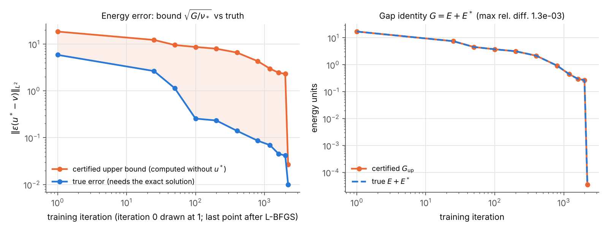
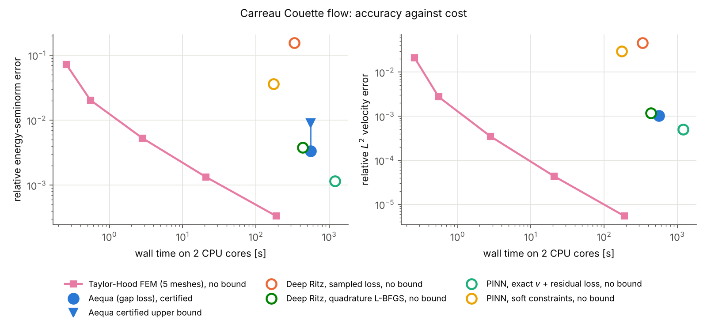
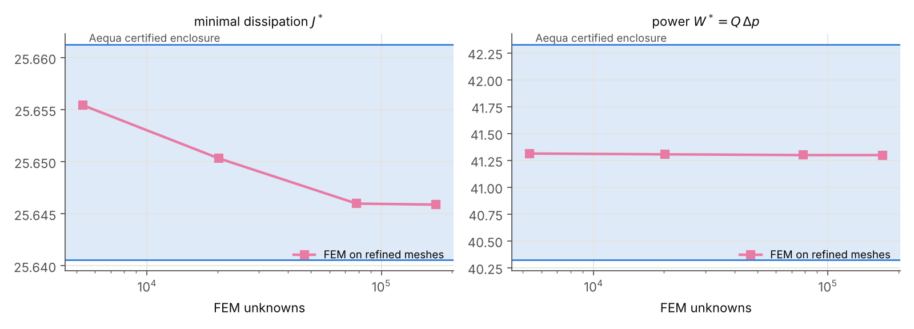

# Aequa benchmarks

All numbers on this page are produced by the scripts in this folder and read from `results/*.json` (`python make_report.py` rewrites the page). Machine: a 2-core cloud CPU, no GPU, float64; networks are kept small accordingly, and all times are wall times on that machine.

## 0. Exactness: what holds for every network

These are not accuracy results. They check that the certificate machinery is exact, on random (untrained) networks, against the exact developed channel flow of each law (`b0_exactness.py`, same checks as `tests/test_identity.py` and `tests/test_power.py`).

| law | gap $G$ | $E+E^*$ (from the exact solution) | relative defect |
|---|---|---|---|
| Newtonian(mu=1.0) | 5.298005295e+01 | 5.298005295e+01 | 3.5e-12 |
| PowerLaw(K=1.0, n=0.5) | 9.115177289e+01 | 9.115177290e+01 | 1.3e-10 |
| Bingham(mu_p=1.0, tau_y=0.5) | 7.357855195e+01 | 7.357855196e+01 | 5.1e-11 |
| HerschelBulkley(K=3.72, n=0.41, tau_y=3.31) | 2.509823119e+03 | 2.509823119e+03 | 2.5e-11 |
| Carreau(eta0=1.0, eta_inf=0.05, lam=2.0, n=0.5) | 5.079580136e+01 | 5.079580136e+01 | 8.8e-11 |
| CarreauYasuda(eta0=1.0, eta_inf=0.05, lam=2.0, n=0.4, a=1.5) | 5.034491088e+01 | 5.034491088e+01 | 8.6e-11 |
| Casson(K=0.5, tau_y=0.3) | 8.715302596e+01 | 8.715302599e+01 | 2.1e-10 |
| Cross(eta0=1.0, eta_inf=0.05, lam=2.0, m=0.7) | 3.112956861e+01 | 3.112956862e+01 | 1.1e-10 |

The identity $G=E+E^*$ (Stokes) holds to 2.1e-10 relative for all 8 laws, although the networks are far from the solution. It checks at once that $v$ is exactly divergence free with exact boundary data, that $m$ is exactly equilibrated, that the conjugates $F^*$ are right, and that the quadrature is accurate.

The certified power enclosure contains the exact power for all 7 laws tested (all contained). For untrained networks it is wide, as it must be (its width scales with $G$); Section 1 shows it for a trained network.

## 1. Couette flow of a Carreau fluid (exact solution known)

**Problem.** Annulus $0.5<r<1$, inner cylinder rotating with $\Omega=2$, outer at rest, Stokes flow, Carreau law $\eta=\eta_\infty+(\eta_0-\eta_\infty)(1+(\lambda\dot\gamma)^2)^{(n-1)/2}$ with $\eta_0=1$, $\eta_\infty=0.05$, $\lambda=2$, $n=0.5$. The exact solution follows from the torque balance $\tau_{r\theta}=C/r^2$ (`common.CouetteExact`). The domain is curved and multiply connected, and the exact stress transmits a torque, so Aequa needs its Michell term.

**Setup, identical for every neural method.** Networks of depth 3 and width 32, 2000 Adam steps (learning rate 0.003, cosine decay, batch 1024) then 200 L-BFGS iterations, float64, 2 CPU threads. Errors of every method are measured by the same code on the same polar Gauss rule. The finite-element reference is Taylor-Hood P2-P1 on isoparametric meshes (scikit-fem), Picard iteration.

| method | rel. energy error $\|\varepsilon(u^*-v)\|/\|\varepsilon(u^*)\|$ | rel. $L^2$ velocity error | guaranteed error bound | wall time |
|---|---|---|---|---|
| **Aequa** (gap loss, exact $v$ and exact $m$) | 0.34% | 0.103% | **yes**: $\le$ 0.89% (of $\|\varepsilon(v)\|$) | 561 s |
| Deep Ritz, same exact $v$, L-BFGS on the deterministic quadrature | 0.38% | 0.116% | no (upper bound on $J^*$ only) | 437 s |
| Deep Ritz, same exact $v$, sampled loss | 15.44% | 4.579% | no (upper bound on $J^*$ only) | 336 s |
| PINN, same exact $v$ + pressure net, residual loss | 0.12% | 0.050% | no | 1193 s |
| PINN, soft constraints (standard) | 3.62% | 2.975% | no | 173 s |
| FEM Taylor-Hood, 368 unknowns | 7.140% | 2.0850% | no | 0.3 s |
| FEM Taylor-Hood, 1312 unknowns | 2.031% | 0.2734% | no | 0.6 s |
| FEM Taylor-Hood, 4928 unknowns | 0.529% | 0.0346% | no | 2.8 s |
| FEM Taylor-Hood, 19072 unknowns | 0.134% | 0.0043% | no | 20.7 s |
| FEM Taylor-Hood, 75008 unknowns | 0.033% | 0.0005% | no | 188.4 s |





**What Aequa certifies for the trained network** (every number computed without the exact solution, then checked against it):

| certified statement | certified value | exact value | holds |
|---|---|---|---|
| minimal dissipation $J^*\in[J(v)-G,\,J(v)]$ | $[4.3512592,\ 4.3512946]$ | 4.3512615 | yes |
| power $W^*$ (Thm 6.4) | $[6.9926,\ 7.0266]$ | 7.0095 | yes |
| $G = E+E^*$ (Thm 2.1) | $G_{\rm up}$ = 3.5389e-05 | $E+E^*$ = 3.5345e-05 (on the error rule) | yes |
| $\nu_*\int|\varepsilon(u^*-v)|^2\le G$, unconditional floor $\nu_*=\eta_\infty$ | 3.54e-05 | 5.02e-06 | yes, effectivity 2.66 |
| $\int\nu_s|\varepsilon(u^*-v)|^2\le G$, sharp tube weight (Cor. 7.4) | 3.54e-05 | 3.00e-05 | yes, effectivity 1.09 (tube condition holds) |

Effectivity is (certified bound / true error) in the norm, so 1 is perfect and every value is $\ge1$ when the bound is valid.

**Reading the results honestly.**

* *Finite elements are faster in 2D.* For a smooth 2D problem, Taylor-Hood reaches the same accuracy in seconds. Aequa's case is not speed: it is that the number it prints is a proved bound, computed without the exact solution. None of the other methods produces one in this form. (FEM can be given guaranteed bounds too, with equilibrated-flux estimators; that was not implemented here.)
* *The bound is tight once the pair is converged.* With the sharp tube weight the certified error is within a factor 1.09 of the truth; with the unconditional floor weight, 2.66.
* *During Adam the certificate is honest but loose.* The first figure shows the velocity becoming accurate long before the gap falls: the stress side lags. The Michell torque coefficient has to grow from 0 to about 3.26 (its trained value), and Adam moves a parameter by at most about the learning rate per step, so with this schedule it needs most of the 2000 steps for that alone. L-BFGS reduces the gap by a factor 7538. At every checkpoint the certified bound was above the true error.
* *Same velocity ansatz, different losses.* With Aequa's exactly admissible velocity, the residual loss reached a smaller error than the gap loss in this run (0.12% against 0.34%), at 2.1 times the cost, but gives no bound. Deep Ritz on a sampled loss stalls, because the dissipation has sampling noise even at the optimum, while the gap density vanishes pointwise at the solution; trained on the deterministic quadrature, Deep Ritz reaches 0.38% (Aequa 0.34%), but still certifies only $J(v)\ge J^*$.
* *Soft constraints cost exactness.* The standard PINN's velocity has divergence 6.0e-02 (L2) and a wall error up to 1.1e-02; it solves a slightly different problem, which no a-posteriori statement can repair.

## 2. Carreau flow past a cylinder in a channel (no exact solution)

**Problem.** Channel $[-3,5]\times[-1,1]$, cylinder of radius 0.3 at the origin, the same Carreau law, developed Carreau profile (mean speed 1, flux $Q=2$) at inlet and outlet, no-slip on walls and cylinder, Stokes flow. Aequa networks of depth 3, width 32; two training budgets. Reference: Taylor-Hood FEM on four meshes; the finest gives $J=25.645890$ and $W=41.29933$, with changes of 9.4e-05 and 1.4e-04 from the previous mesh.

| Aequa training | $G/J$ | certified $J^*$ | certified power $W^*$ | certified $\Delta p=W^*/Q$ | FEM inside all three | time |
|---|---|---|---|---|---|---|
| 2000 Adam + 200 L-BFGS | 0.942% | $[25.48997,\ 25.73238]$ | $[38.2349,\ 44.8530]$ | $[19.1175,\ 22.4265]$ | yes | 717 s |
| 2000 Adam + 2000 L-BFGS | 0.081% | $[25.64058,\ 25.66129]$ | $[40.3239,\ 42.3299]$ | $[20.1620,\ 21.1650]$ | yes | 1693 s |

FEM reference pressure drop: $W/Q=20.64967$. The $J^*$ enclosure has relative width $G/J$. The power and pressure-drop enclosures are wider, of order $\sqrt{G/J}$, because the Carreau law has two growth exponents (certificate note, Thm 6.4); for Newtonian and power-law fluids they are as sharp as the $J^*$ enclosure. The longer L-BFGS phase reduces $G/J$ by a factor 12 and narrows every enclosure; all of them stay consistent with the reference.



| FEM mesh | unknowns | $J(u_h)$ | $W(u_h)$ | $\|\operatorname{div}u_h\|_{L^2}$ | time |
|---|---|---|---|---|---|
| h = 0.2 | 5324 | 25.655442 | 41.31367 | 2.1e-01 | 2.9 s |
| h = 0.1 | 20202 | 25.650344 | 41.30633 | 8.4e-02 | 16.3 s |
| h = 0.05 | 78492 | 25.645984 | 41.29948 | 1.8e-02 | 137.5 s |
| h = 0.035 | 171266 | 25.645890 | 41.29933 | 9.6e-03 | 436.7 s |

The FEM velocity is only discretely divergence free, so $J(u_h)$ is not an upper bound for $J^*$; Aequa's upper end $J(v)$ is, because $v$ is exactly admissible.

## What these benchmarks do not show

* No inertia: every case here is Stokes flow. The inertial certificate ($\theta<1$) is in the library but not benchmarked here.
* No yield-stress law in a trained case (the identity is checked for Bingham, Herschel-Bulkley and Casson in Section 0).
* The quadrature-based $G$ is a converged deterministic quadrature, not an interval enclosure (see `docs/certificate_note.pdf`).
* Small networks and short training on 2 cores; on a GPU, larger networks change the accuracy and timing columns.

## Reproduce

```
pip install -e .[test,bench]
cd benchmarks
python b0_exactness.py
python b1_couette_fem.py
python b1_couette.py aequa deepritz deepritz_quad pinn_hard pinn
python b2_cylinder.py fem && python b2_cylinder.py aequa
python make_figures.py && python make_report.py
```
`AEQUA_BENCH_ITERS` and `AEQUA_BENCH_LBFGS` change the training budget.
